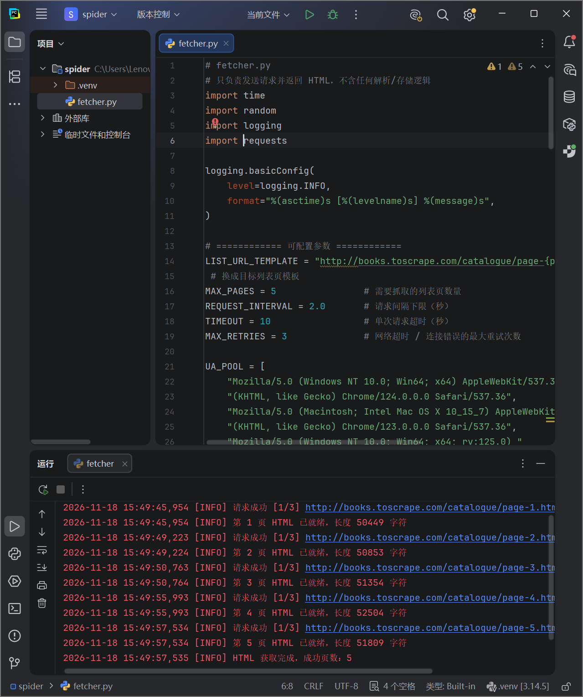
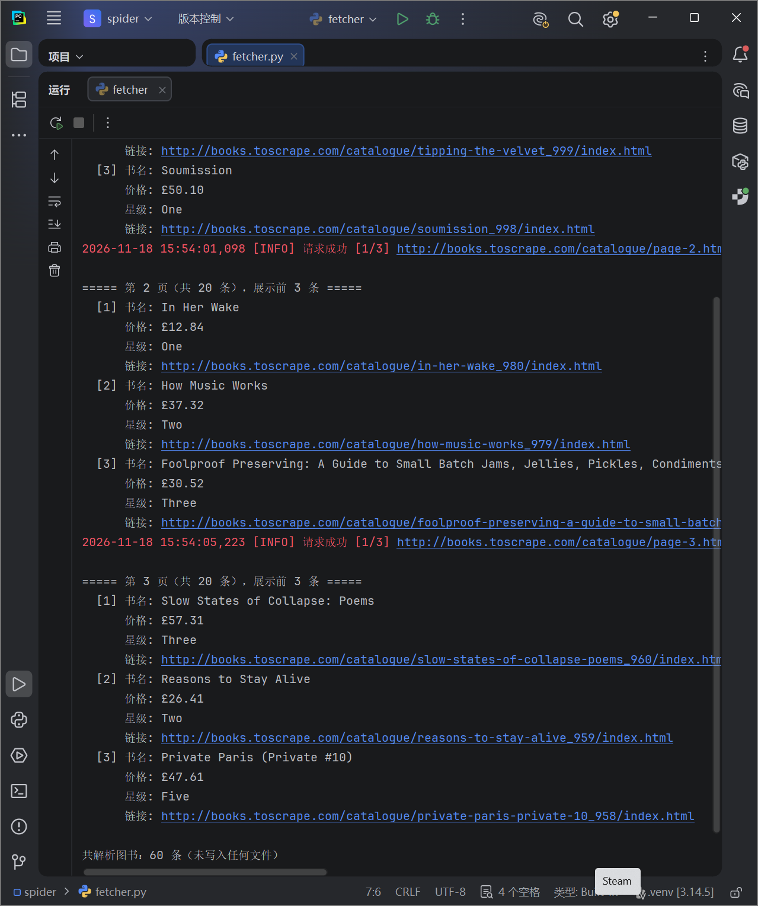
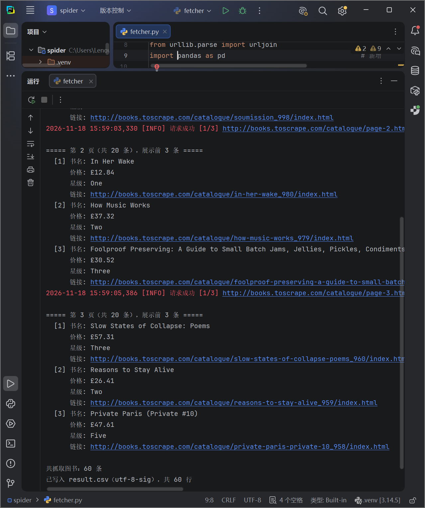
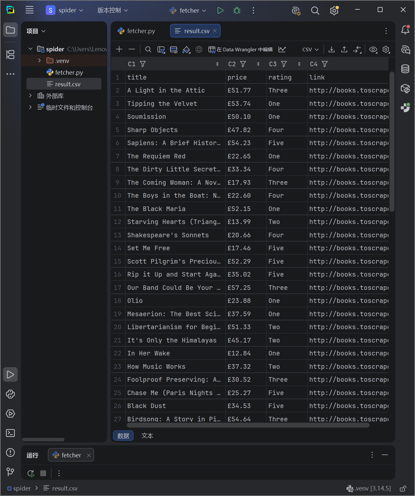

# 实验报告：Python 静态网页爬虫（Vibe Coding 分阶段实现）

| 项目 | 内容 |
| --- | --- |
| 课程 | Python 程序设计 |
| 实验名称 | Python 静态网页数据抓取（Vibe Coding 实验） |
| 姓名 / 学号 | ________ / ________ |
| 完成日期 | 2026-11-18 |
| 仓库地址 | https://github.com/qls-eng/python-spider-lab |
| 运行环境 | Windows 11 + Python 3.14.5 + requests / beautifulsoup4 / pandas |

## 一、实验目的

1. 用 `requests` 完成 HTTP 请求，理解 Session 复用、超时、UA 伪装的作用。
2. 用 `BeautifulSoup` 按 CSS 选择器从静态 HTML 中提取结构化字段。
3. 用 `pandas` 把抓取结果落盘为 Excel 可读的 CSV。
4. 按指导书的 **Vibe Coding 工作流**分阶段推进：请求 → 解析 → 持久化 → 重构为类，每阶段单独跑通再进入下一阶段。
5. 处理真实网络环境的不确定性：限速、重试、编码兜底、字段缺失兜底。

## 二、目标站点与字段映射

目标站点：`http://books.toscrape.com/catalogue/page-{page}.html`

Books to Scrape 是公开的爬虫练习沙盒站点，纯静态 HTML、无 JavaScript 渲染，适合静态爬虫训练；同时不含登录、付费与个人隐私数据，符合合规要求。

指导书要求抓"标题、时间、作者、链接"四字段，本项目用等效字段完成同样训练：

| 实验要求字段 | 本项目字段 | 提取来源 |
| --- | --- | --- |
| 标题 | `title` 书名 | `h3 > a` 的 `title` 属性 |
| 时间 | `price` 价格 | `p.price_color` 文本 |
| 作者 | `rating` 星级 | `p.star-rating` 的 class 第二个值 |
| 链接 | `link` 详情页地址 | `h3 > a` 的 `href` + `urljoin` 转绝对地址 |

说明：真实新闻站点普遍有反爬策略与版权限制，选沙盒站点是为了把训练重点放在"请求—解析—持久化"这条主链上，而不是对抗反爬。

## 三、分阶段实现与验证

### 阶段 1：请求层

先只做"发请求、拿 HTML、打印长度"，不写任何解析逻辑。运行 `python fetcher.py`（`MAX_PAGES = 5`）的真实日志：



日志要点：

- 5 页连续请求全部 `status=200`，每页 HTML 长度 50k 字符上下；
- 时间戳相邻差值约 2~4 秒，验证了 `REQUEST_INTERVAL = 2.0` 的节流生效；
- 末尾打印"HTML 获取完成，成功页数：5"，说明失败页跳过的计数逻辑正常。

### 阶段 2：解析层

在拿到 HTML 后加入 `parse_books`，每页打印前 3 条解析结果做人工抽查：



抽查结果与站点页面一致：书名、价格（`£` 前缀）、星级英文单词（One/Two…Five）、详情页绝对链接。

### 阶段 3：持久化层

用 `pandas.DataFrame` 汇总，`to_csv(encoding="utf-8-sig")` 落盘：



- 运行结束打印"共抓取 60 条"，与 3 页 × 每页 20 条一致；
- `result.csv` 实际 61 行（1 行表头 + 60 行数据），核对命令与结果：

```text
result.csv 总行数(含表头): 61
title,price,rating,link
A Light in the Attic,£51.77,Three,http://books.toscrape.com/catalogue/a-light-in-the-attic_1000/index.html
Tipping the Velvet,£53.74,One,http://books.toscrape.com/catalogue/tipping-the-velvet_999/index.html
Soumission,£50.10,One,http://books.toscrape.com/catalogue/soumission_998/index.html
```

用 Excel 直接打开验证编码（`utf-8-sig` 带 BOM，中文列头不乱码）：



### 阶段 4：重构为类

指导书要求把脚本重构成类。全部逻辑收敛为 `NewsCrawler`，按四个层次划分：

| 层次 | 成员 | 职责 |
| --- | --- | --- |
| 会话层 | `__enter__` / `__exit__` / `close` / `_create_session` / `session` | 持有并复用 Session，退出时关闭连接池 |
| 请求层 | `_throttle` / `fetch_html` / `fetch_list_pages` | 节流、UA 伪装、超时重试、编码兜底、分页 |
| 解析层 | `parse_books`（静态方法） | 从列表页提取四字段 |
| 持久化层 | `save_csv` | 汇总写 `utf-8-sig` CSV |
| 编排层 | `run` | 串起抓取、预览打印、落盘、统计 |

原模块级常量（`MAX_PAGES`、`REQUEST_INTERVAL`、`TIMEOUT`、`MAX_RETRIES`、`OUTPUT_CSV`）全部改为构造参数：

```python
with NewsCrawler(max_pages=3, request_interval=2.0, output_csv="result.csv") as crawler:
    crawler.run()
```

**重构等价性回归**：重构前把 `result.csv` 备份为 `result_before_refactor.csv`，重构后用同样参数（`--pages 3`）重跑，再用 `csv` 模块逐行比对：

```text
before rows: 61 | after rows: 61
identical: True
```

字段、列序、编码、行数、每行内容全部一致，证明重构没有改变对外行为。

## 四、功能与异常处理对照

| 特性 | 实现 | 验证 |
| --- | --- | --- |
| UA 池随机切换 | `random.choice(UA_POOL)` | 多次运行日志中的 `User-Agent` 不同 |
| 请求节流 | 记录上次请求时间，不足间隔则 `sleep` | 日志时间戳相邻差值 ≥ 2 秒 |
| 超时 / 连接错误重试 | 最多 3 次，退避 2s、4s | 无效域名实测 3 次失败后返回 `None` |
| 状态码异常不重试 | HTTP 错误直接放弃该页 | 404 页面只记录一次，无重试 |
| 编码兜底 | 非 UTF-8 时用 `apparent_encoding` | 中文站点不出现乱码 |
| 字段缺失兜底 | 取不到时填 `""` | 构造残缺 HTML，未抛异常 |
| 分页跳过失败页 | 单页失败不影响整体 | 失败页计数与实际抓取数一致 |

完整的 10 条用例（含 3 条边界、1 条回归）见 `docs/测试用例.md`；其中 TC-09（全部页面失败）当时标注为"未覆盖，风险项"，未做显式空结果提示，属于已知改进点，不在本报告中记为"通过"。

## 五、合规与限制

- 只抓公开练习站点，无登录、无付费、无个人信息；
- 请求间隔 ≥ 2 秒，单次运行页数受控；
- 未使用代理池、验证码识别等绕过手段。

已知限制：

1. 仅支持静态 HTML；Vue / React 等动态渲染站点用 `requests` 只能拿到空壳，需改用浏览器自动化；
2. 解析依赖站点当前 DOM 结构，站点改版会导致选择器失效（返回空列表且不报错，属"静默失败"，目前靠每页条数人工发现）；
3. 指导书的进阶挑战（动态站点抓取、两种方案的复杂度/效率对比）本次未实现，仅覆盖静态场景。

## 六、小结

- Vibe Coding 的价值在"分阶段可验证"：请求先跑通再写解析，问题定位范围小，不会一锅乱炖。
- 网络程序必须按"会失败"来设计：限速、重试、超时、编码兜底都不是可选项。
- 重构前先留基线（备份 CSV）再比对，才能把"功能不变"这句话变成可验证的结论，而不是口头保证。

## 七、交付清单

| 交付物 | 位置 |
| --- | --- |
| 源码 | `fetcher.py`（`NewsCrawler` 类，254 行） |
| 抓取结果 | `result.csv`（61 行 = 表头 + 60 条） |
| 依赖 | `requirements.txt` |
| 需求澄清 | `docs/需求澄清清单.md` |
| AI 协作记录 | `docs/ai对话记录.md`（含 R7 重构轮次） |
| 测试用例 | `docs/测试用例.md`（10 条，含未覆盖项说明） |
| 复盘 | `docs/复盘.md` |
| 运行截图 | `docs/images/run_fetch_log.png`、`run_parse_output.png`、`run_persist_output.png`、`result_csv_excel.png` |
